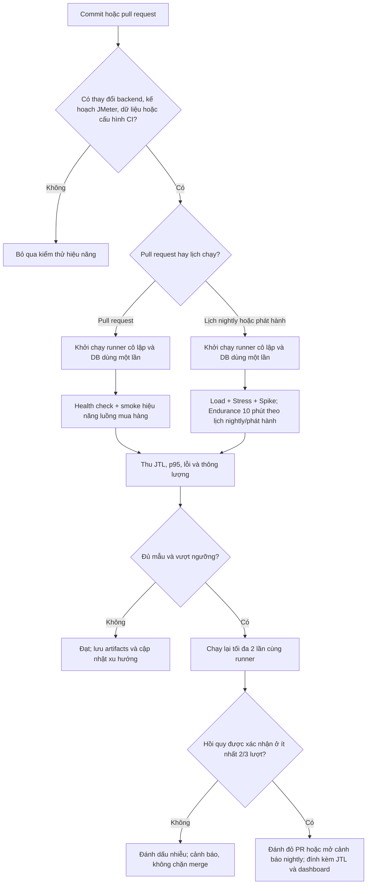

# Nhiệm vụ 3 — Đề xuất kiểm thử hiệu năng liên tục

**Mã số sinh viên:** 23120037  
**Ngày:** 20 tháng 11 năm 2026  
**Trạng thái:** Đề xuất kiến trúc; chưa triển khai thành quy trình CI thực tế.

## Mục tiêu

Theo dõi các commit ảnh hưởng tới SUT, tự chọn cấp độ kiểm thử hiệu năng phù hợp, so sánh độ trễ p95 với mốc tham chiếu cùng môi trường, rồi báo lỗi hồi quy sau khi xác nhận lại để hạn chế báo động giả. Kết quả phải lưu được JTL, báo cáo HTML và thông tin commit để nhóm có thể tái kiểm tra.

## Cơ sở và điều chỉnh theo repository hiện tại

- Repository chưa có thư mục `.github/workflows` hoặc cấu hình CI được kiểm tra thấy.
- `backend/package.json` có lệnh `test` mẫu luôn thoát với lỗi “no test specified”; hiện chưa có bộ kiểm thử tự động để pipeline gọi.
- `run_servers.sh` dùng đường dẫn tuyệt đối từ máy phát triển và gọi `killall node`; không phù hợp chạy nguyên trạng trên runner dùng chung.
- `backend/database.js` tạo cơ sở dữ liệu `backend/database.sqlite`, xóa rồi tạo lại các bảng và seed dữ liệu lúc khởi động. CI cần chạy trong workspace cô lập, chỉ dùng cơ sở dữ liệu tạm và tuyệt đối không trỏ tới dữ liệu của máy phát triển.
- Các kế hoạch hiện có chạy luồng Login → Product List → Add to Cart → Checkout. Dữ liệu kiểm thử hiện dùng chung một tài khoản, vì vậy mỗi worker cần được làm sạch/reset trước lượt chạy và không chạy chồng nhiều job cùng cơ sở dữ liệu.

Trước khi bật cổng chặn merge, cần thêm health check và assertion nội dung phản hồi ở mức nghiệp vụ, chuẩn hóa cách khởi chạy backend bằng đường dẫn tương đối, và tạo dữ liệu kiểm thử cô lập. Các bước này là điều kiện triển khai đề xuất, không phải thay đổi đã thực hiện.

## Luồng pipeline

## Chính sách kích hoạt và cấp độ kiểm thử

| Sự kiện | Khi nào chạy | Bộ kiểm thử | Tác động |
|---|---|---|---|
| Pull request / commit có sửa `backend/**`, `submission/plans/**`, dữ liệu kiểm thử hoặc workflow CI | Mỗi lần có thay đổi liên quan | Health check, assertion chức năng, smoke JMeter rút gọn cho cùng luồng giao dịch; giới hạn người dùng và thời lượng | Có thể chặn merge khi lỗi chức năng hoặc hồi quy hiệu năng được xác nhận |
| Commit mới lên nhánh chính | Sau khi merge thay đổi liên quan | Load ngắn và so sánh mốc tham chiếu | Cảnh báo sớm; không thay thế bộ nightly đầy đủ |
| Lịch nightly | Mỗi đêm hoặc sau khi có thay đổi backend | Load, Stress, Spike; Endurance 10 phút | Tạo xu hướng, cảnh báo nhóm; không chặn commit đã merge |
| Chuẩn bị phát hành | Trước release hoặc theo yêu cầu thủ công | Đủ Load/Stress/Spike và Endurance, trên runner cố định | Cổng phát hành theo ngưỡng đã hiệu chuẩn |

Nếu thay đổi chỉ ảnh hưởng giao diện frontend, có thể bỏ qua bài kiểm thử API này. Nếu sửa route hoặc truy vấn cụ thể, vẫn chạy luồng đầu-cuối để bảo đảm các nhóm xác thực, đọc và giao dịch tiếp tục được kiểm tra.

## Ngưỡng và quy tắc xác nhận

1. Dùng các ngưỡng Nhiệm vụ 2 làm điểm khởi đầu: tỷ lệ lỗi JTL ≤1%, p95 tổng thể ≤16 ms và p95 Checkout ≤18 ms. Đây là ngưỡng tạm thời lấy từ máy phát triển hiện tại, không áp thẳng lên runner CI khác biệt.
2. Trên runner CI, thu ít nhất 10 lần chạy thành công để lập mốc tham chiếu riêng cho từng cấu hình. So sánh cùng phiên bản JMeter, dữ liệu, runner, số người dùng và thời gian ramp-up.
3. Cảnh báo khi p95 vượt ngưỡng tuyệt đối đã hiệu chuẩn hoặc tăng hơn 20% so với trung vị 10 lần thành công gần nhất. Thông lượng giảm hơn 10% là dấu hiệu cần điều tra, không tự nó chứng minh lỗi nếu tải hoặc thời gian chạy không tương đương.
4. Bảo đảm đủ mẫu trước khi kết luận p95; nếu smoke quá ngắn, tăng thời lượng hoặc đánh dấu “không đủ dữ liệu” thay vì đạt tự động.
5. Khi có ngưỡng vượt hoặc lỗi, chạy lại tối đa hai lần trên cùng runner và cùng dữ liệu sạch. Chỉ gắn nhãn hồi quy đã xác nhận nếu ít nhất 2 trong 3 lượt vượt cùng ngưỡng. Lỗi chức năng hoặc HTTP ngoài dự kiến không được bỏ qua theo quy tắc đa số.
6. Lưu JTL, dashboard HTML, stdout/stderr backend, phiên bản công cụ, SHA commit, thông số tải và kết quả so sánh làm artifacts. Không đưa mật khẩu/JWT vào log công khai.

## Chi phí và báo động giả

| Đánh đổi | Tác động | Cách giảm rủi ro |
|---|---|---|
| Thời gian CI và chi phí runner | Smoke mỗi pull request tăng thời gian phản hồi; các kế hoạch hiện tại có tổng thời lượng cấu hình khoảng 15 phút cho Load + Stress + Spike + Endurance, chưa tính khởi động và chạy lại. Ba lượt xác nhận có thể làm tăng thời gian/chi phí đáng kể. | Chạy bài rút gọn trên pull request; dành Endurance 10 phút cho nightly hoặc phát hành; chỉ kích hoạt theo đường dẫn/thành phần liên quan. |
| Nhiễu trên runner dùng chung | CPU, bộ nhớ, mạng hoặc job khác làm p95 dao động, tạo báo động giả và cản merge. | Dùng runner riêng/cố định cho benchmark; chạy lại cùng cấu hình; dùng trung vị nhiều lần chạy và quy tắc xác nhận 2/3. |
| Mốc tham chiếu sai lệch | Mốc lấy từ máy khác, thay đổi dữ liệu hoặc khác phiên bản JMeter có thể báo hồi quy không chính xác. | Gắn mốc với loại runner, phiên bản công cụ và cấu hình; cập nhật mốc khi có thay đổi hạ tầng đã được review, không tự cập nhật sau lần chạy lỗi. |
| Ngưỡng quá rộng | Giảm báo động giả nhưng có thể bỏ sót suy giảm nhỏ hoặc chậm. | Theo dõi xu hướng p95 và thông lượng qua nhiều commit; hiệu chỉnh ngưỡng theo mục tiêu dịch vụ và kết quả thực nghiệm. |
| Tải kiểm thử chưa đại diện | Bài hiện tại chỉ đến 15 người dùng, dùng một tài khoản và chạy API cùng máy với JMeter; có thể không phát hiện điểm nghẽn ở quy mô lớn hơn hoặc môi trường production. | Ghi rõ phạm vi, thêm tài khoản/cách ly giỏ hàng, dùng runner độc lập và tăng tải định kỳ theo năng lực hạ tầng cho phép. |
| Tạo dữ liệu hoặc trạng thái bẩn | Login lockout, giỏ hàng dùng chung hoặc dữ liệu đơn hàng tích lũy làm kết quả không ổn định. | Tạo DB dùng một lần cho mỗi job, reset dữ liệu giữa các lần chạy, dùng tài khoản kiểm thử riêng và chạy tuần tự với SQLite hiện tại. |

## Kết luận

Mô hình hai tầng cân bằng tốc độ phản hồi và độ bao phủ: smoke kiểm soát merge cho thay đổi liên quan, còn nightly/phát hành chạy đủ các kịch bản và theo dõi xu hướng. Cổng chặn chỉ nên bật sau khi có assertion nghiệp vụ, runner ổn định và mốc tham chiếu riêng. Đây là đề xuất, chưa có workflow CI được triển khai trong repository.

